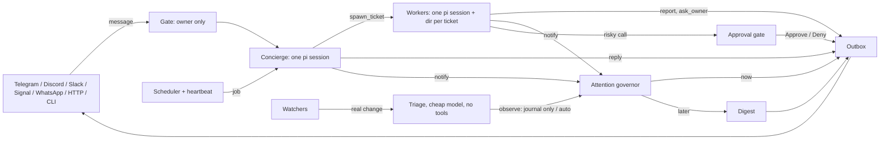

# vigil

An always-on personal agent that lives on a small server, talks to you from the chat apps on
your phone, works in the background, and speaks up on its own only when it's worth your attention.

Built on [pi](https://github.com/earendil-works/pi). Its domain model is adapted from DeepSeek's
[dsh-superagent](https://github.com/deepseek-ai/dsh-superagent-prototype), and its core promises
are model-checked with TLA+, using the formal verification method from
[pstack](https://github.com/cursor/plugins/tree/main/pstack).

```
you (Telegram) ─ "find the cheapest flight to Lisbon in March, and tell me if it drops below $400"
vigil          ─ "On it. I'll report back, and I've set a watcher on the fare."
                 … 20 minutes later, from a background worker …
vigil          ─ "✅ Cheapest: TAP, 14 Mar, $438, 1 stop. Booking link: …"
                 … three days later, 09:00, in the morning digest …
vigil          ─ "Lisbon fare dropped to $392 (TAP, 14 Mar)."
```

## Why another agent

Most "always-on" agents fail the same way: they talk too much. Each ping costs attention, and an
agent that can act for you all day can also waste your whole day. vigil is built around one rule,
taken from dsh-superagent:

> **Take as little of the owner's attention as possible, and give as much value as possible.**

That rule is enforced in code, not only in prompts:

- **An attention governor** sits between "the agent wants to say something" and "your phone
  buzzes". Quiet hours, a daily interrupt budget (default 3), a minimum gap between interrupts,
  dedup, and a Mute / Less button on every interruption. Everything that can wait goes into one digest at times you
  choose, or into vigil's next reply when you write first. The governor is a pure state machine,
  model-checked with TLC and property-tested against the same rules.
- **It acts when you ask, or when a rule you wrote allows it.** Proactive work from watchers starts
  in `observe` mode: vigil records what it *would* have done, and you switch to `auto` once that
  looks right.
- **Risky actions wait for your thumb.** `git push`, `sudo`, `rm -rf`, MCP tools that send or
  delete: the call is held, you get Approve/Deny buttons, and the approval is bound to that exact
  call, single-use, and expires. Credentials and vigil's own database are off limits entirely.

## What it does

| | |
| --- | --- |
| **Chat from your phone** | Telegram (recommended), Discord DMs, Slack DMs, Signal (via signal-cli), WhatsApp (unofficial, opt-in), ntfy push, an HTTP API for iOS Shortcuts, and a terminal. One conversation across all of them |
| **Background work** | Longer tasks become *tickets*: each gets its own pi session, its own directory and the full coding toolset. Workers report back when there's a result, a question, or a blocker. Reply to a result to continue that task |
| **Asks, not guesses** | A worker that needs a decision asks one question with buttons, then waits |
| **Schedules** | "Remind me at 5", "every weekday at 8:30 brief me", "every Sunday clean up my downloads". Cron with your time zone; missed runs during downtime fold into one |
| **Watchers** | Web pages, RSS/Atom feeds, command output. Checked without a model; only a real change wakes triage on a cheap model |
| **Heartbeat** | Hourly look around `HEARTBEAT.md` and stuck work. It usually decides to say nothing, and it skips the model call when there's nothing to look at |
| **Memory** | Plain files: `MEMORY.md` (in every prompt, capped), daily journals, notes. Consolidated nightly by a "dream" job and versioned with git |
| **Two subscriptions** | ChatGPT (Codex) via device-code login, works on a headless server, even from your phone with `/login codex`. OpenCode Go via API key. Roles fall back across providers on rate limits and outages |
| **Skills and MCP** | Workers load vigil's shipped skills (including formal verification) and any MCP servers in `mcp.json` |
| **Panel** | A small web page: what needs you first, then work in progress, the digest queue, the attention budget, schedule and activity |

## Try it without any accounts

```bash
git clone https://github.com/Ayesha-Imr/vigil-agent && cd vigil-agent && npm ci --ignore-scripts && npm run build && node dist/cli.js demo
```

It runs a day with vigil in your terminal: a reminder, background research, an approval for a `git
push`, and a night-time notice held for the morning. The daemon, governor, scheduler, tools and
approval gate are all real; only the model is scripted. No accounts needed.

## Quick start

Requirements: Node 22.19+, a machine that stays on (a $5 VPS, a home server, a Raspberry Pi 5).
Java is optional (for `vigil verify`).

```bash
git clone https://github.com/Ayesha-Imr/vigil-agent && cd vigil-agent
npm ci --ignore-scripts && npm run build
npm link            # puts `vigil` on your PATH
```

```bash
vigil init          # your name, time zone, Telegram bot token, quiet hours
```

```bash
vigil login codex   # ChatGPT Plus/Pro: opens a device code, works over SSH
```

```bash
vigil login opencode   # OpenCode Go: paste your API key (or set OPENCODE_API_KEY)
```

```bash
vigil doctor        # check everything
```

```bash
vigil start         # foreground; see "Run it always" below
```

Then message your bot. `/help` lists the commands.

### Telegram in two minutes

1. In Telegram, talk to **@BotFather** → `/newbot` → copy the token into `vigil init`.
2. Start vigil. Its log prints a one-time code, valid for 15 minutes: `telegram has no owner yet … /pair K7Q2M9XW4T`.
3. Send `/pair K7Q2M9XW4T` to your bot. You are now its owner. Everyone else is dropped before a model
   ever sees their message, and the code is gone. (Or put your numeric user id from
   **@userinfobot** into `vigil init` and skip pairing.)

### Discord

Create an application at <https://discord.com/developers>, add a bot, enable the **Message Content**
intent, invite it to a server you share, and copy your user id (Developer Mode → right-click
yourself → Copy User ID). vigil talks to you in DMs.

### Slack

vigil uses Socket Mode, so no public URL is needed. At <https://api.slack.com/apps> create an app,
then: turn on **Socket Mode** and make an app-level token with `connections:write` (`xapp-…`); add
the bot scopes `chat:write`, `im:history`, `im:read`, `im:write`, `reactions:read`, `files:read` and
`users:read`; under **Event Subscriptions** subscribe to the bot events `message.im` and
`reaction_added`; turn **Interactivity** on (no URL needed with Socket Mode); under **App Home**
allow users to send messages in the Messages tab. Install it to your workspace, copy the bot token
(`xoxb-…`), and give both tokens to `vigil init` (or `VIGIL_SLACK_BOT_TOKEN` and
`VIGIL_SLACK_APP_TOKEN`). Your member id (`U…`, from your profile → ⋮ → Copy member ID) goes in
`owner.identities.slack`. Slack treats a leading `/` as a slash command, so to pair or use a
command, type a space first: ` /pair K7Q2M9XW4T`. Buttons are Block Kit buttons; replies to a message
go in its thread.

### Signal

vigil talks to a [signal-cli](https://github.com/AsamK/signal-cli) daemon, which you install and run
yourself. signal-cli is unofficial but speaks the real Signal protocol. Give vigil its own Signal
account (a second number): link signal-cli as a secondary device of the phone that holds it
(`signal-cli link -n vigil`, scan the QR code under Settings → Linked devices) or register the
number directly with signal-cli. Then run `signal-cli -a +15551234567 daemon --http 127.0.0.1:8080`
(0.13 or newer) and set `channels.signal` to `{ "url": "http://127.0.0.1:8080", "account":
"+15551234567" }` and your own number (E.164, `+…`) in `owner.identities.signal`. Like WhatsApp,
choices come as a numbered list and you reply with a digit; approvals are typed as `/approve <id>`
or `/deny <id>`, never a bare digit.

### WhatsApp (read this first)

vigil can link to WhatsApp as a device through [Baileys](https://github.com/WhiskeySockets/Baileys).
This is **unofficial**, and WhatsApp may ban the number. Use a spare number, never your main one.
The official Cloud API doesn't fit a personal agent: it needs paid templates for anything sent
24 hours after your last message. Enable WhatsApp in `vigil init`, then scan the QR code printed on
the first `vigil start`. WhatsApp has no buttons, so vigil numbers the choices and you reply with a
digit.

### iPhone shortcut / anything with HTTP

```bash
curl -s -X POST http://127.0.0.1:7777/api/message \
  -H "authorization: Bearer $VIGIL_HTTP_TOKEN" -H 'content-type: application/json' \
  -d '{"text":"what is on my plate today?"}'
```

The call waits for vigil's answer and returns `{"reply": "..."}`. Reach it through
[Tailscale](https://tailscale.com) or a reverse proxy with TLS. Keep the port off the open
internet.

### Push notifications without a chat bot

Set an [ntfy](https://ntfy.sh) topic in `vigil init` and install the ntfy app. Critical notices go
out at top priority. With `channels.http.publicUrl` set, notices also get action buttons, each with
its own signed URL, so the API token never leaves your server.

### From pi on your laptop

The repo is also a [pi package](https://github.com/earendil-works/pi/blob/main/packages/coding-agent/docs/packages.md).
Install it into your everyday pi, and pi can hand long tasks to vigil (`vigil_ticket`), push a
notice to your phone (`vigil_notify`), or ask vigil what it knows (`vigil_ask`). When a pi run
takes longer than 10 minutes, your phone gets a ping, so you can walk away from the laptop. You
also get vigil's skills, including formal verification.

```bash
pi install git:github.com/Ayesha-Imr/vigil-agent
```

```bash
export VIGIL_URL=https://vigil.your-tailnet.ts.net VIGIL_HTTP_TOKEN=…   # then: pi, and /vigil status
```

## Run it always

**systemd (VPS, home server):**

```bash
vigil service --write
```

```bash
systemctl --user daemon-reload && systemctl --user enable --now vigil && loginctl enable-linger $USER
```

**Docker:**

```bash
npm ci --ignore-scripts && npm run build && docker compose build
```

```bash
docker compose run --rm vigil init && docker compose run --rm vigil login codex && docker compose up -d
```

## Talking to vigil

Just write. vigil answers quick things itself and hands longer work to a background worker. Some
useful phrasings:

- "every weekday at 8:30, look at my calendar and GitHub and give me a 3-line brief"
- "watch https://… and tell me when the deadline changes"
- "remember that I prefer aisle seats"
- "stop pinging me about CI" (mutes the topic), or react 😴 to a notice
- Reply to a worker's message to continue that task. Reply to a question to answer it.

| Command | |
| --- | --- |
| `/status` | what's going on, budget, model |
| `/tickets`, `/stop <id>` | background work |
| `/digest` | what's waiting for the digest, now |
| `/jobs`, `/memory` | what's scheduled; what vigil remembers about you |
| `/why` | the attention governor's recent decisions, and why |
| `/mute <topic> [hours]`, `/unmute <topic>` | silence a topic |
| `/mode off\|observe\|auto` | proactive work from watchers |
| `/pause`, `/resume` | kill switch: keep listening, start and send nothing new |
| `/new` | fresh conversation (memory is kept) |
| `/login codex`, `/login opencode <key>` | log in from your phone |

Commands work without a model, so they still work when a provider is down.

## How it works



- Every inbound message is stored as a **trigger** before anything happens, keyed so a redelivery
  is a no-op. Every outbound message goes through a durable **outbox**: stored first, sent with
  backoff, in order per conversation and ticket.
- The **concierge** is one long-lived pi session. Inputs that aren't from you (jobs, worker
  reports, heartbeats) are private: it can only reach you through `notify`, which passes the
  governor.
- **Workers** follow dsh-superagent's ticket model: a mandate that says what you asked and how far
  the work may go, reports (`ready`, `blocked`, `failed`, `dropped`), a structured question
  instead of a question buried in a report, a slot limit with one slot reserved for a ticket you
  just wrote to, and a recovery note after a restart so nothing outside is done twice blindly.
- **Triage** of watcher events runs on the cheap model with no tools at all: untrusted input,
  no private data, no side effects (Meta's "rule of two").

[docs/DESIGN.md](docs/DESIGN.md) has the full model, [docs/FAQ.md](docs/FAQ.md) the common
questions, and [docs/DEPLOY.md](docs/DEPLOY.md) the server setup. [docs/research/](docs/research/) holds the
research this was built from: the pi harness internals, and the 2026 landscape of always-on agents
(DSH, OpenClaw, Hermes, Grok, ChatGPT Pulse) with best practices for proactive notifications.

### Tuning the attention policy

```bash
vigil simulate --max 2 --gap 90 --quiet 23:00-07:30
```

This replays your last week of notices (or a synthetic noisy week) through the governor under a
policy you're considering, and shows day by day how many times your phone would have buzzed, how
many digests you'd have got, and what was dropped as a repeat. Nothing is sent.

### Checking a model before you rely on it

```bash
vigil eval                                  # all scenarios, your configured models
```

```bash
vigil eval --model opencode-go/kimi-k3 urgent injection worker
```

Nine scenarios run against your real models, each in a throwaway home with a fake chat: a reminder
becomes a job, a quick question gets a short direct answer, research goes to a worker, a heartbeat
with nothing to say stays silent, an outage is urgent and a blog post is not, a preference reaches
`MEMORY.md`, an instruction hidden in pasted text is not followed, and a worker finishes a small
task. Each scenario checks what vigil *did*, not its wording. Use it to compare models.

## Formal verification

The parts where a bug costs the most and tests reach the least are model-checked with TLA+:

| Spec | What it proves (within bounds) |
| --- | --- |
| `verification/governor` | The budget, critical cap, quiet hours, mutes and dedup always hold; no notice is lost or sent twice; every waiting notice is eventually resolved |
| `verification/approvals` | A risky call runs only after the owner approved *that exact call* before expiry; approvals are single-use; denied or expired ones never run; a non-owner can't approve |
| `verification/outbox` | Messages of one conversation (and one ticket) keep their order; nothing is lost; duplicates only come from a crash or a send timeout; two daemons on one home never both send |
| `verification/scheduler` | One trigger per slot; a job never overlaps itself within its lease; no slot is lost, also across a crash; "at" jobs fire once |
| `verification/workers` | No ticket runs twice; slot limits plus one reserved slot for the owner; the owner's message is never lost silently or starved; a stopped ticket stays stopped; retries are bounded |

```bash
vigil verify        # or: bash verification/run.sh   (needs Java)
```

Every property has been shown to fail on a broken variant of the model (`verification/mutate.sh`
and each spec's `mutants/`). The model checks found 20 real defects in the code, each replayed on the
TypeScript and fixed; [docs/REPORT.md](docs/REPORT.md) lists them.
The property tests in `test/` check the TypeScript against the same rules, and
`verification/run.sh --trace` checks that recorded runs of the real governor are behaviours of its
model (trace validation). See
[verification/README.md](verification/README.md) for bounds and what is not covered. The
project-local skills in `.claude/skills/` and `.pi/skills/` tell a coding agent how to rerun and
maintain each check when the code changes. vigil's own workers ship with pstack's formal
verification skills, so they can do the same for your code.

## Configuration

`~/.vigil/config.json` (or `$VIGIL_HOME`). `vigil init` writes it; everything has a default.

```jsonc
{
  "owner": {
    "name": "Ayesha",
    "timezone": "Asia/Karachi",
    "identities": { "telegram": ["123456789"], "discord": ["987654321"] },
    "notify": ["telegram", "discord", "ntfy"]        // where proactive messages go, in order
  },
  "channels": {
    "telegram": { "token": "…" },                    // or VIGIL_TELEGRAM_TOKEN
    "slack": { "botToken": "xoxb-…", "appToken": "xapp-…" }, // or VIGIL_SLACK_BOT_TOKEN / _APP_TOKEN
    "signal": { "url": "http://127.0.0.1:8080", "account": "+15551234567" }, // a signal-cli daemon
    "http": { "port": 7777, "token": "…" }           // the panel and API
  },
  "models": {                                         // "provider/*" = any model of that provider
    "concierge": ["openai-codex/*", "opencode-go/*"],
    "worker":    ["openai-codex/*", "opencode-go/*"],
    "triage":    ["opencode-go/*", "openai-codex/*"],
    "dream":     ["opencode-go/*", "openai-codex/*"]
  },
  "attention": {
    "quietHours": { "start": "22:30", "end": "08:00" },
    "digestTimes": ["09:00", "18:00"],
    "maxInterruptsPerDay": 3, "minGapMinutes": 60, "criticalPerDay": 3,
    "dedupWindowMinutes": 720, "defaultExpiryHours": 36,
    "silentDigests": true                             // digests arrive without a buzz
  },
  "proactive": { "mode": "observe", "heartbeatMinutes": 60, "dreamAt": "04:00" },
  "workers": { "max": 2 },
  "approvals": { "ttlMinutes": 30 }
}
```

- `~/.vigil/policy.json`: your own approval rules, checked before the defaults:
  `{"rules": [{"tool": "bash", "match": "\\bterraform apply\\b", "verdict": "risky", "reason": "changes infra"}], "writableRoots": ["/home/me/projects"]}`
- `~/.vigil/memory/HEARTBEAT.md`: what the hourly heartbeat should keep an eye on.
- `~/.vigil/pi/mcp.json`: MCP servers for the concierge and workers (same format as pi's).
- `~/.vigil/skills/`: your own skills, loaded alongside vigil's.

## Security notes

- vigil runs commands as the user it runs as. Give it its own user, or a container, and don't run
  it as root.
- Only owner identities can talk to it; anyone else's messages are dropped before anything is
  stored. Messages, web pages, files and tool output are treated as data, and they can't widen
  permissions: the gate, the allowlist and the governor are code. A message you forward is marked
  as someone else's words, so it is data too.
- **Approvals come from your chat app**, where your identity is checked. Over the HTTP API (panel,
  ntfy actions, `/api/message`), approve/deny, typed `/approve`, `/mode` and `/login` are refused
  by default, because any process on the machine that finds the token could send them, and that
  includes the agent's own tools. Set `channels.http.allowApprovals` only if tools can't read
  vigil's files (a sandbox or container).
- vigil's own config, policy, credentials and transcripts are off limits to every tool, ahead of
  any rule you add. File tools are checked by where a path really leads (relative paths, `..` and
  symlinks included), not by how it is spelled. Secret environment variables are removed from the process after startup, so
  the shells the agent runs don't inherit them.
- `web_fetch` refuses loopback, private and cloud-metadata addresses on every redirect hop. The
  check runs inside the connection's own DNS lookup, so the address checked is the address
  dialled (no DNS-rebinding window).
- Work vigil infers from untrusted content (a watched page) gets web tools but no file tools, so an
  injected page cannot read a file and send it out.
- **Shell sandbox.** When [bubblewrap](https://github.com/containers/bubblewrap) is installed
  (`apt install bubblewrap`), every command the agent runs gets a read-only system, with vigil's
  home and the usual credential stores (`~/.ssh`, `~/.gnupg`, `~/.aws`, `~/.kube`, `~/.docker`,
  `~/.netrc`, …) hidden, and only its own folder and `/tmp` writable. GitHub CLI's login stays
  visible so workers can use `gh`; pushes still need your approval.
  `vigil doctor` says whether it's active. The approval gate's regexes are a second layer on top:
  without the sandbox they are a guard rail, not a boundary, since a determined program can find a
  way around a regex.

## Development

```bash
npm ci --ignore-scripts
npm test                  # unit, property and end-to-end tests (no network, no API keys)
vigil chat                # a terminal chat; attaches to the running service if there is one
npm run check             # type check
npm run verify            # TLA+ model checking
node --experimental-strip-types scripts/demo-panel.ts   # the panel with made-up data
```

The end-to-end tests run the real daemon, real pi sessions and real tools against pi's faux
provider and a fake chat channel. No tokens are spent.

## Credits

- [pi](https://github.com/earendil-works/pi) by Earendil Works: the agent harness underneath.
- [dsh-superagent](https://github.com/deepseek-ai/dsh-superagent-prototype) by DeepSeek: the domain
  model (trigger, mandate, ticket, report, attention), the attention principle and the accept
  modes.
- [pstack](https://github.com/cursor/plugins/tree/main/pstack) by Lauren Tan: the formal
  verification and statechart skills (MIT, vendored in `skills/`).
- Ideas from OpenClaw (heartbeat), Hermes Agent (silent runs, cheap pre-checks), and research on
  notification batching.

MIT licensed.
