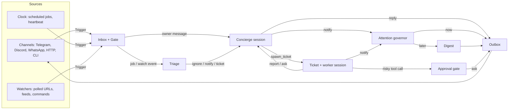

# vigil design

vigil is an always-on personal agent for one person (the **owner**). It runs as a daemon on a
small server, talks to the owner through the chat apps already on their phone, does long work in
the background, and speaks up on its own only when that is worth the owner's attention.

It is built on [pi](https://github.com/earendil-works/pi) (the agent loop, tools, sessions,
providers, skills) and borrows its domain model from DeepSeek's
[dsh-superagent](https://github.com/deepseek-ai/dsh-superagent-prototype), cut down from "an agent for
a team" to "an agent for one person".

## Principle

**Take as little of the owner's attention as possible, and give as much value as possible.**
(dsh-superagent's principle, applied to one person.)

- vigil acts when the owner asks, or when a rule the owner wrote allows it (a job, a watcher).
- vigil speaks when the owner must act or can use a result. Everything else waits for a digest
  or is never sent.
- A message that interrupts costs more than one that waits. Interruptions are budgeted, and the
  budget is enforced in code, not by asking the model nicely.
- Safety properties that matter (budget, quiet hours, approvals, no double-runs) are checked by
  model checking (TLA+), and the code is property-tested against the same rules.

## Flow

## Concepts

| Concept | What it is | Rules it keeps |
| --- | --- | --- |
| Owner | The one person vigil serves, with one identity per channel | Only owner identities can start work, approve actions or change settings. Other senders are dropped before they reach a model |
| Source | A stream of events: a channel, the clock, a watcher | Persists its read position; a restart never replays an event |
| Trigger | One immutable event, keyed `(source, external_id)` | Stored before it is processed; accepting the same key twice is a no-op |
| Gate | The deterministic first step on every Trigger | Owner message → explicit. Job the owner created → explicit (the owner wrote the rule). Watcher event → proactive candidate. Anything else → dropped and counted |
| Concierge | The long-lived pi session that talks to the owner | One brain across channels: a message from Telegram and one from Discord land in the same conversation. Replies go to the channel the message came from |
| Ticket | A unit of background work with its own pi session and directory | Created only by the concierge (`spawn_ticket`) or by triage in `auto` mode. Holds a Mandate: the owner's request text, the origin, and the strength. States: `open` → `ended`; a reply from the owner resumes it |
| Report | What a worker says about its ticket | `progress` (internal) · `waiting` · `ready` · `blocked` · `failed` · `dropped`. Only `ready`, `blocked`, `failed` and questions reach the owner |
| Attention | A structured question that waits for the owner | One concrete question, optional choices. Delivered at `high` urgency, answered by reply or button |
| Approval | A risky tool call held until the owner says yes | Bound to the exact call (hash of tool + arguments), single use, expires. A denied, expired or replayed approval never runs the call |
| Notification | A message vigil starts on its own | Has an urgency (`critical`, `high`, `normal`, `low`), a topic and a dedup key. Always passes the governor |
| Governor | The policy between "the agent wants to say something" and "the phone buzzes" | See below. A pure state machine, model-checked |
| Digest | The batch of things that could wait | Sent at digest times, or folded into vigil's next reply when the owner writes first |
| Outbox | Every outbound message, stored before it is sent | Retried with backoff; messages of one ticket to one conversation keep their order |
| Job | A schedule the owner created (`cron`, `every`, `at`) with a prompt | One run per slot; missed slots during downtime coalesce into one run; a job never overlaps itself |
| Heartbeat | A built-in job that wakes the concierge to look around | Reads `HEARTBEAT.md`, open tickets and the digest; usually decides to say nothing |
| Memory | Plain files the agent reads and edits | `MEMORY.md` (curated, in every prompt), `journal/YYYY-MM-DD.md` (append-only), `notes/` (free form). A nightly "dream" job consolidates the journal into `MEMORY.md` |

### Accept modes for proactive work

Copied from dsh-superagent, because it is the right way to start an agent that acts without being
asked:

| Mode | Watcher events and other inferred work |
| --- | --- |
| `off` | Never become candidates |
| `observe` (default) | Triage runs; what vigil *would* have done is written to the journal and shown in the panel, and nothing is sent or started |
| `auto` | Triage may notify or open a ticket |

Jobs the owner created are explicit and run in every mode.

## The attention governor

Every notification passes `Governor.offer(item, now)`, which returns one decision:

| Decision | When |
| --- | --- |
| `deliver` | Allowed to interrupt now |
| `hold` | Quiet hours: kept until quiet hours end, then delivered in the morning digest |
| `digest` | Low urgency, or over budget: kept for the next digest |
| `drop:duplicate` | Same dedup key delivered or queued within the dedup window |
| `drop:muted` | The owner muted this topic |

Rules, in order:

1. Muted topic → `drop:muted` (even `critical`; muting is the owner's explicit word).
2. Duplicate dedup key within the window → `drop:duplicate`.
3. `critical` → `deliver`, ignoring quiet hours and the normal budget, but limited by its own
   cap (`criticalPerDay`). Over that cap it is treated as `high`. A runaway model cannot page the
   owner all night.
4. `low` → `digest`.
5. Quiet hours → `hold`.
6. `high` or `normal` within budget (`maxInterruptsPerDay` in any rolling 24 h, and at least
   `minGapMinutes` since the last interrupt) → `deliver`.
7. Otherwise → `digest`.

Digest flush: at each configured digest time (outside quiet hours) all held and digested items go
out as **one** message; when the owner writes to vigil, pending digest items are offered to the
concierge to mention in its reply, and are then marked delivered. Every item ends in exactly one
of: delivered alone, delivered in a digest, dropped (with reason), expired (past its `expiresAt`).

Feedback: an owner can mute a topic (`/mute topic 1d`, a 🔕 reaction, or by saying so; the agent has
a `mute_topic` tool). A 👎 reaction on a notification lowers that topic's urgency for 7 days.

Invariants the model checker verifies (see `verification/`):

- **Budget**: in every 24 h window, interrupts of urgency `high`/`normal` ≤ `maxInterruptsPerDay`;
  `critical` deliveries ≤ `criticalPerDay`.
- **Quiet**: nothing but `critical` is delivered during quiet hours (digests included).
- **NoMuted**: no delivery on a muted topic.
- **NoDuplicate**: two deliveries never share a dedup key within the dedup window.
- **Conservation**: every offered item is in exactly one state; no item is lost.
- **EventuallyResolved** (liveness): every offered item is eventually delivered, dropped or expired.

## Tickets and workers

A worker is a pi session with the full coding tool set, its own directory under
`~/.vigil/work/<ticket-id>`, the shipped skills (including the formal verification skills) and these
extra tools: `report`, `ask_owner`, `notify`, `remember`. Its system prompt is the worker prompt plus
the Mandate. A worker that ends its turn without a final report is reported `waiting`.

Concurrency: at most `maxWorkers` tickets run a turn at once. The owner's message to a ticket
can always run (one reserved slot), so new background work never blocks a conversation with
existing work (dsh-superagent's rule).

Restart: a ticket that was mid-turn restarts with a recovery note telling the worker to check its
directory and any outside state before repeating an outside action.

## Approval gate

A pi extension on `tool_call` classifies each call:

- `safe` → runs.
- `risky` → blocked until approved. Examples: `rm -rf` outside the ticket directory, `sudo`,
  `git push --force`, `curl … | sh`, writing outside allowed roots, any `send_message` to someone who
  is not the owner, spending money.
- `forbidden` → refused with a reason (credential files, the vigil database itself).

Rules are data (`policy.json`), not prompt text. The gate asks the owner with the exact command,
binds the approval to `sha256(tool, args)`, and expires it after `approvalTtlMinutes`.

## Models and providers

Two subscriptions are first class:

- **ChatGPT (Codex)**: pi provider `openai-codex`, OAuth login from the ChatGPT Plus/Pro plan.
- **OpenCode Go**: pi provider `opencode-go`, API key from `opencode.ai`.

Each role (`concierge`, `worker`, `triage`, `dream`) has an ordered list of `provider/model`
candidates. The first one with credentials wins. When a call fails with a quota, rate-limit or
server error, the role falls back to the next candidate and the failed one cools down. Model IDs
come from pi's catalog at runtime; `vigil models` lists them, and nothing in the code hardcodes one.

Credentials are pi's own `auth.json` under vigil's state dir; `vigil login` runs pi's login flow.

## Storage

One SQLite database (`node:sqlite`, no native build) at `~/.vigil/vigil.db`, plus pi session JSONL
files and memory files. Every state change that leads to an outside action is stored first and
done afterwards (dsh-superagent's "stored work"), so a crash can repeat an action but never lose
one, and idempotency keys make the repeats harmless where the outside world allows it.

## Channels

| Channel | Library | Notes |
| --- | --- | --- |
| Telegram | grammY, long polling | Recommended. No public URL needed; inline buttons for approvals; reactions for feedback |
| Discord | discord.js | DMs with the owner; buttons |
| WhatsApp | Baileys (unofficial, linked device) | QR pairing; use a secondary number. Unofficial: may break or be rate-limited |
| ntfy | HTTP | Push-only notifications to the ntfy app, for people who do not want a chat bot |
| HTTP | built in | `POST /api/message` for iOS Shortcuts, scripts and webhooks; token auth |
| CLI | built in | `vigil chat` for local use and tests |

## Panel

A small web page served by the daemon (token auth). It lists first what waits for the owner
(approvals, questions, blocked tickets), then running tickets, the digest queue, the interrupt
budget, jobs and recent triggers. A healthy state takes no space.
